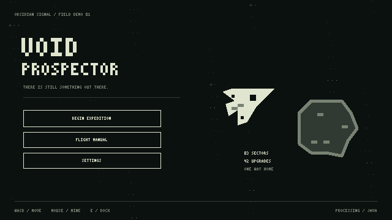
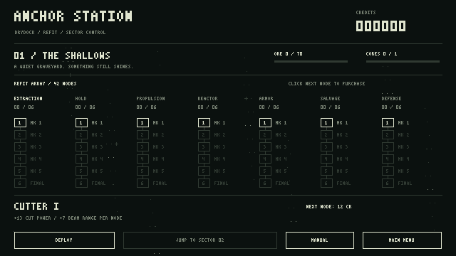

# VOID PROSPECTOR

An original, playable **Processing Java** space-mining demo inspired by the mining / return / upgrade loop of *Ship Miner*. All artwork, typography, ships, asteroids and interface elements are generated by the sketch. No external game assets are used.



## Play

Requires **desktop Java 21+**, Bash, curl and sha256sum. A JDK is optional: the setup script downloads a pinned Eclipse Java compiler and Processing Core 4.3.1, verifies SHA-256 checksums, then compiles the Java sketch.

```sh
./run.sh
```

On Windows, install Git for Windows and Java 21+, open **Git Bash** in this folder, and run the same command. The launch and test scripts select the Windows `;` classpath separator automatically. After compilation, you can also launch from Windows Command Prompt:

```bat
java -Dvoid.save=.local/save.properties -cp "build/classes;lib/core-4.3.1.jar" VoidProspector
```

The window is 1280 × 720. Rendering happens at 640 × 360 with `noSmooth()` on both Processing surfaces and exact integer scaling. Text uses a custom 3 × 5 bitmap font. There is no texture interpolation or font antialiasing.

This is a Java-mode Processing application (`VoidProspector extends PApplet`) compiled directly against Processing Core, without requiring the Processing IDE. Source lives in `src/`.

### Controls

| Input | Action |
| --- | --- |
| WASD / arrows | Move |
| Mouse | Aim |
| Hold left mouse | Mine asteroids / damage drones |
| Shift | Boost; consumes reactor energy |
| E near Anchor Station | Dock, sell, repair, recharge and save |
| Escape | Pause / resume |
| Click a next upgrade node | Purchase at the station |

The beam and boost share energy. Release the beam to recharge. Bright square-cored asteroids contain signal cores; the minimap marks them. Cores have their own storage and can be collected even when the ore hold is full. Follow the BASE marker home. Dock within 96 world units of the station.

### Three-stage campaign

| Sector | Banked ore | Signal cores | Conditions |
| --- | ---: | ---: | --- |
| 01 · The Shallows | 70 | 1 | Sparse field, three light security drones, no radiation |
| 02 · Shattered Belt | 160 | 2 | Denser, tougher rocks; six drones; coolant vents |
| 03 · The Hollow Star | 280 | 3 | Richest field; nine stronger drones; stellar radiation |

Collect and **deposit** both objectives, then use the station's jump button. Each sector has its own cumulative objectives, deterministic layout and increased ore sale value. Vents and the star pulse for the final three seconds of each ten-second cycle; their rings indicate the danger zone. The station is a safe area that destroys incoming bolts.

Complete sector 03 at the station to reach the ending. Free play remains available afterward. Expect several short sorties per sector. The 42-node tree offers more upgrades than a normal campaign can afford: choose a build or keep mining in free play.

### Station refit tree: 7 branches × 6 nodes

Each node requires its predecessor in the same branch. Branches are independent, so several builds are viable. The next cost is `12 + 18 × currentLevel + 5 × currentLevel²` credits.

| Branch | Per-node benefit |
| --- | --- |
| Extraction | +13 beam damage per second; +7 reach |
| Hold | +18 ore capacity |
| Propulsion | +14 movement speed; boost scales with it |
| Reactor | +24 energy; +6 energy recharge per second |
| Armor | +32 hull |
| Salvage | +18 collection radius; +12% sale value |
| Defense | +0.65 hull regeneration per second while not firing; improved damage resistance |



## Saves and menus

Title menu, continue, confirmed new game, flight manual, station, pause, settings, recovery and ending are included. Settings toggle particles and screen shake.

With `run.sh`, saves are written atomically at docking, purchases and sector jumps to the ignored `.local/save.properties` inside the project. Direct Java launches default to `~/.voidprospector/save.properties`. A destroyed ship loses **unsold cargo**, while banked ore, credits, bought upgrades and unlocked sectors remain. Recovering regenerates the sector. Closing during a flight also discards unsold cargo. A corrupt save is reported and can be replaced with a confirmed new expedition.

To use an alternate save path:

```sh
JAVA_OPTS='-Dvoid.save=/absolute/path/save.properties' ./run.sh
```

## Development and cloud environment

```sh
./tools/setup.sh     # Verify/download pinned jars and compile
./test.sh            # Headless progression + real flight simulation tests
```

This cloud machine initially has a headless JRE. Optional cloud prerequisites are installed **inside `.local/`**, using Debian's signed package metadata and package integrity checks. No root installation is needed.

```sh
./tools/setup-cloud.sh
./tools/with-display.sh ./run.sh
```

`with-display.sh` uses a supplied display or creates a private Xvfb session, selects the local desktop JRE when present, and cleans up the virtual display when the application exits. A virtual display is for testing; it does not expose a browser preview of this desktop application.

Renderer smoke check, using a separate save path:

```sh
./tools/with-display.sh java \
  -Dvoid.smoke=true -Dvoid.save=/tmp/void-render-smoke.properties \
  -cp 'build/classes:lib/core-4.3.1.jar' VoidProspector
```

This launches the actual Processing window, draws all menu types and all three sectors, writes screenshots under `build/`, and exits with `RENDER_SMOKE_OK`. `build/window.png` is the full scaled window; the other images are the internal framebuffer.

Verified during implementation: **380 checks passed**, including all 42 purchases, save validation and roundtrips, thrust, reactor recharge, beam mining, ore/core collection, cargo limits, docking, enemy firing, projectile damage, death, both radiation hazards and a complete three-sector mining/deposit/jump campaign. Real Processing rendering passed under Xvfb. The scaled window was checked pixel by pixel: all 230,400 source pixels expand into uniform 2 × 2 blocks.

Use the existing checkout under `/workspace/VoidProspector`; each cloud task already has an isolated workspace. No extra Git worktree is needed. Processes must be restarted after a cloud snapshot is restored.

## Layout

- `src/VoidProspector.java` — Processing window, procedural art, menus and gameplay simulation.
- `src/GameState.java` — economy, upgrade effects, campaign progression and atomic save files.
- `src/PixelFont.java` — original bitmap alphabet.
- `src/GameTests.java` — deterministic behavioral tests, no GUI dependency.
- `tools/setup.sh` — versioned, checksum-verified dependencies and compilation.
- `tools/setup-cloud.sh` / `tools/with-display.sh` — optional local cloud GUI support.

Processing Core is distributed under LGPL; Eclipse ECJ is distributed under EPL. They are downloaded from Maven Central rather than committed. See [THIRD_PARTY.md](THIRD_PARTY.md).
